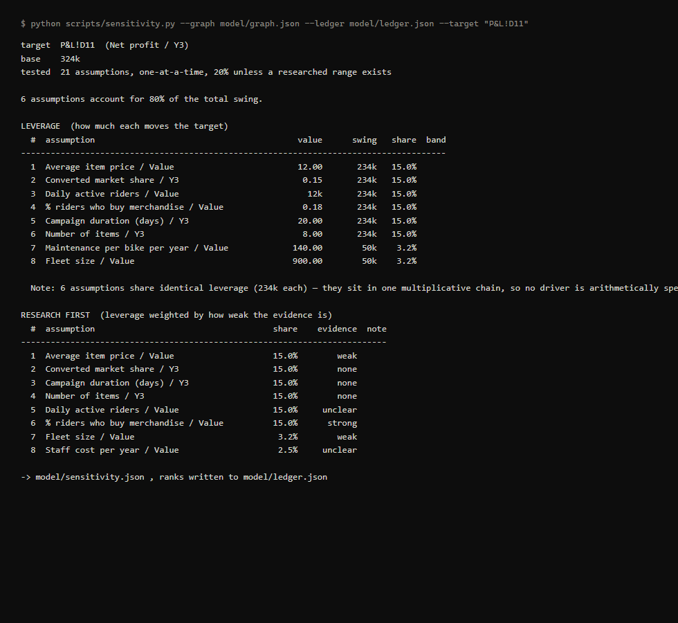

# financial-model-audit

Audit, stress-test and harden spreadsheet financial models — business plans, venture
projections, business cases, grant budgets.

A financial model is an argument about the future wearing the costume of arithmetic.
The formulas are rarely the hard part; the argument lives in the assumptions, and for
a venture that does not exist yet those assumptions are mostly guesses about the
outside world. That is fine — until nobody can tell which numbers are evidenced and
which were typed in on a Tuesday, at which point the whole model inherits the
credibility of its weakest cell, and the person presenting it finds that out in the
room.

This skill makes every number say where it came from, finds the few that actually
decide the answer, and puts honest ranges around them.



*Run against the bundled synthetic fixture. Six drivers move the answer by exactly
the same amount — they sit in one multiplicative chain, so arithmetic cannot rank
them. Evidence quality can, and does.*

## What it does

- **Parses** the workbook into a dependency graph with a self-contained formula
  evaluator, and **proves the parse** by recomputing every formula against the values
  Excel cached. If the graph does not reproduce the model, you are told before any
  analysis is reported.
- **Extracts every assumption** into a ledger — value, meaning inferred from the
  surrounding labels, whatever note the modeller left, and what it flows into.
- **Finds structural defects** that survive eyeballing: rates multiplied by durations
  and sold as populations, totals that skip a row, formulas that differ from their
  siblings, subsets larger than the set they came from, magic numbers buried in
  formulas. Grouped by root cause, so one mistake across three year-columns reads as
  one finding.
- **Ranks assumptions by leverage**, then re-ranks by *leverage weighted by weak
  evidence* — because driver models are multiplicative chains where a dozen inputs
  often tie exactly, and arithmetic then cannot tell you what to research. Evidence
  quality can.
- **Guides research** toward ranges with real sources, with an explicit test against
  *benchmark laundering* (a real statistic about a sector quietly promoted into a
  venture-specific assumption — the characteristic way AI-assisted models go wrong).
- **Builds scenarios** from researched ranges, optionally mapped to decision
  thresholds (covenant, break-even, funding band) so you learn which assumptions can
  flip the decision rather than just move the number.
- **Writes it back into the client's own workbook**: an Assumptions Ledger tab, a
  Findings tab, provenance in a note on every assumption cell, industry-standard
  blue/black input/formula colouring. Plus a standalone HTML summary for people who
  will never open a spreadsheet.

The deliverable is their model, hardened — not a report about their model. They keep
a file that opens on any machine in ten years with no dependency on us.

## Install

```bash
# User-scoped (available across all your projects)
cp -r financial-model-audit ~/.claude/skills/

# Project-scoped
cp -r financial-model-audit <your-project>/.claude/skills/

python -m pip install 'openpyxl>=3.1'   # the only dependency
```

Or run `./install.sh` from this directory.

## Use

Just point Claude at a model:

> *"Audit the financial model in inputs/business-plan.xlsx — I'm presenting it to the
> investment committee on Thursday and I want to know what they'll find."*

Or run the scripts directly; they are plain Python, order-independent, and their JSON
is stable, so you can build your own pipeline around them.

```bash
python scripts/model_graph.py inputs/model.xlsx --out model/graph.json --verify
python scripts/ledger.py     --graph model/graph.json --out model/ledger.json --csv exports/ledger.csv
python scripts/audit.py      --graph model/graph.json --out model/findings.json
python scripts/sensitivity.py --graph model/graph.json --ledger model/ledger.json \
    --target "Sheet!E23" --out model/sensitivity.json
python scripts/scenarios.py  --graph model/graph.json --ledger model/ledger.json \
    --auto --targets "Sheet!E23" --out model/scenario_results.json
python scripts/render.py     --xlsx inputs/model.xlsx --graph model/graph.json \
    --ledger model/ledger.json --findings model/findings.json \
    --sensitivity model/sensitivity.json \
    --out exports/model-hardened.xlsx --html exports/summary.html
```

## How it is built

Numbers are computed by deterministic code; judgment is made by the model reading the
references. The scripts parse, recompute, rank and render — no LLM guesses at
arithmetic, and every reported number is reproducible. The references
(`grading-rubric.md`, `research-protocol.md`, `audit-checklist.md`) carry the parts
that need someone who has built models before.

That split is also what makes the skill portable: the deterministic core is plain
Python with no vendor dependency, and the judgment layer is plain instruction
documents.

### Scripts

| Script | Does |
|---|---|
| `model_graph.py` | xlsx → dependency graph + formula evaluator; `--verify` proves the parse |
| `ledger.py` | assumptions → ledger (json/csv); re-runs preserve your grades |
| `audit.py` | 7 structural checks, grouped by root cause |
| `sensitivity.py` | leverage + research-priority ranking; optional decision bands |
| `scenarios.py` | named override sets; `--auto` builds cases from researched ranges |
| `render.py` | hardened workbook + standalone HTML summary |

### Supported formulas

Arithmetic, percentages, comparisons, string concatenation, absolute and cross-sheet
references, ranges, and **defined names** (`=Revenue*Growth`).

| Group | Functions |
|---|---|
| Aggregation | `SUM AVERAGE MEDIAN MIN MAX COUNT COUNTA PRODUCT SUMPRODUCT` |
| Conditional | `IF AND OR NOT IFERROR SUMIF SUMIFS COUNTIF COUNTIFS AVERAGEIF` |
| Lookup | `VLOOKUP HLOOKUP INDEX MATCH` |
| Financial | `NPV XNPV IRR XIRR` |
| Maths | `ABS ROUND ROUNDUP ROUNDDOWN SQRT POWER` |

Anything outside this set is reported by `--verify` with the exact cells affected,
rather than failing quietly. That gate matters more than the list: it is the
difference between "this model is not fully supported" and confidently wrong numbers.

### Layouts and languages

Tested against deliberately different shapes: periods across columns and down rows
(transposed), labels beside values and above them, monthly grids, multi-sheet models
with lookup tables and named ranges, and models in Spanish. Result cells are found by
label in several languages (English, Spanish/Galician/Portuguese, French, German,
Italian, Dutch) and, when that fails, structurally — terminal formulas with the
deepest dependency trees, which is what a result looks like in any language.

The label-reading audit checks are heuristics over what people name things, so a
clean audit means "nothing recognisable tripped", not "the model is clean". Sector
vocabulary is extensible with `--vocab extra.json` on `audit.py` and `ledger.py`.

## Where it came from

Extracted from business-case work on venture and circular-economy business models,
where the recurring problem was never the arithmetic — it was that the number
deciding the answer turned out to be a guess nobody had noticed, usually the day
before a committee met.

## License

MIT.
