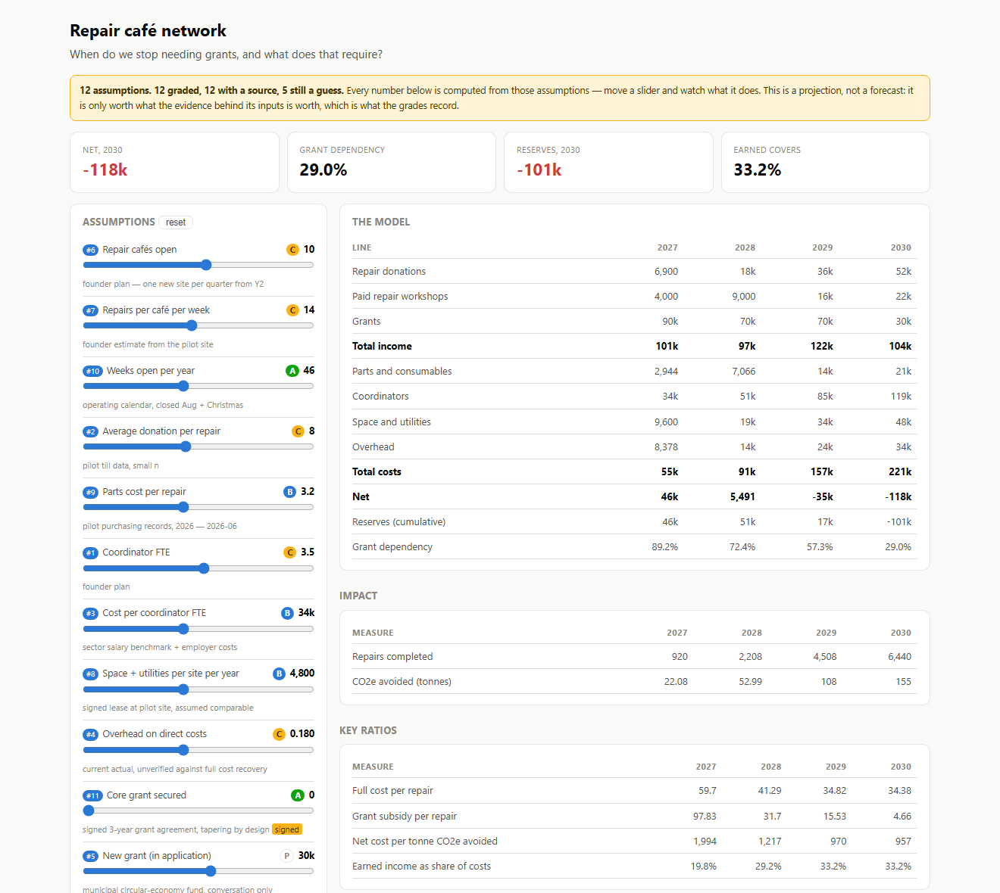

# sustainable-business-model

Build, refine and stress-test the financial model of a social or environmental
enterprise — circular economy ventures, community businesses, impact startups,
charities with trading income, grant-funded programmes.

Social and environmental enterprises are modelled badly for a structural reason:
the people who understand the venture are rarely the people who can build a
spreadsheet, and the tools assume you are already an analyst. So the numbers get
made up the week before a funding deadline, and the founder ends up defending a
model they did not build and cannot inspect.

This starts from a different premise. A founder who cannot write a formula can
absolutely tell you whether *"repair donations = repairs completed × average
donation per repair"* describes how the money actually arrives — and that check
catches the errors worth catching. So the model lives in a small YAML spec they
can read, and everything else is generated from it.

They also ask a different question. A commercial model asks "how much profit?"; a
social enterprise asks **"when do we stop needing grants, and what has to be true
for that?"** That is a first-class output here, not an afterthought.



*The bundled worked example. Every assumption carries a grade and its source; drag a
slider and the whole model recalculates in the browser. One file, no server, works
offline.*

## What it does

- **Reads what they already have** — pitch deck, grant application, notes, a
  half-finished spreadsheet — and lists every number with the words around it. It
  does not guess the model: deciding that "€4,800" is annual rent rather than a
  deposit is judgment, and a regex that guessed wrong would be worse than nothing,
  because nobody would check it.
- **Holds the model as a readable spec.** Drivers with their grade and source,
  lines as plain formulas, thresholds as questions. Diffable, versionable, and
  executable by anything — not locked in cell references or in this tool.
- **Understands blended finance.** Categorise a line `earned` / `grant` /
  `investment` / `inkind` / `cost` / `impact` and grant dependency, cost recovery,
  reserves and impact ratios compute themselves.
- **Finds the five numbers that matter.** Driver models are multiplication chains,
  so many drivers have *identical* leverage and a tornado chart is a row of equal
  bars. When that happens the tool says so, and ranks by leverage weighted by how
  weak the evidence is — a high-leverage number from a signed lease needs nothing;
  the same leverage on "founder estimate" is where the risk lives.
- **Guards against benchmark laundering** — a real sector statistic quietly
  promoted into a venture-specific assumption. It is how AI-assisted models go
  wrong, because every step looks defensible and only the conclusion is fiction.
- **Renders an interactive report** — one self-contained HTML file. The spec is
  compiled to JavaScript, so everything recalculates as sliders move. No server, no
  API key, works offline, emails to a funder who will install nothing.
- **Exports a funder-ready spreadsheet** — because they will ask for the Excel
  however good the HTML is. Assumptions in blue with grade and source beside them,
  calculated lines as real formulas.

## Install

```bash
cp -r sustainable-business-model ~/.claude/skills/        # or <project>/.claude/skills/
python -m pip install 'pyyaml>=6' 'openpyxl>=3.1'         # required
python -m pip install pypdf python-docx python-pptx       # optional, for intake
```

Or run `./install.sh`.

## Use

Point Claude at whatever exists:

> *"Here's our pitch deck and last year's costs in inputs/. We're applying for a
> grant in three weeks and I need a financial model that survives their questions —
> especially 'when do you stop needing us'."*

Or drive the scripts directly:

```bash
python scripts/intake.py      inputs/ --out out/intake.md
python scripts/model.py       spec.yaml --check
python scripts/explore.py     spec.yaml --target net --out out/explore.json
python scripts/explore.py     spec.yaml --scenarios
python scripts/report.py      spec.yaml --out out/report.html --explore out/explore.json
python scripts/export_xlsx.py spec.yaml --out out/model.xlsx
```

`assets/example-repair-network.yaml` is a complete worked example — a repair café
network with blended grant funding, volunteer economics, CO₂ impact and a grant
taper. Run it to see the shape.

## The spec

```yaml
drivers:
  sites:            {label: Repair cafés open, values: [2, 4, 7, 10], grade: C,
                     source: founder plan}
  avg_donation:     {label: Average donation per repair, values: [7.5, 8, 8, 8],
                     grade: C, source: pilot till data, small n}
  grant_new:        {label: New grant (in application), values: [0, 0, 30000, 30000],
                     grade: partner, deal_stage: exploration}
lines:
  repairs:          {formula: sites * repairs_per_site_week * weeks_open, category: impact}
  donation_income:  {formula: repairs * avg_donation, category: earned}
  grants:           {formula: grant_core + grant_new, category: grant, restricted: true}
thresholds:
  - name: Grant-free operation
    test: total_earned >= total_costs
    meaning: Earned income covers full costs. The point of the whole exercise.
```

That is the whole model. A founder can read it, argue with it, and keep it.

## How it is built

Numbers are computed by deterministic Python; judgment lives in the reference docs.
No LLM guesses at arithmetic.

Two safeguards, because two engines are only an asset if they agree:

- `report.py` **verifies its own compiled JavaScript** against the Python results
  and refuses to pass silently on a mismatch. Otherwise a transpiler bug would show
  a founder confident numbers that are simply wrong.
- Expressions are parsed with Python's own parser against a whitelist, so a spec is
  data, not a program, and can never execute arbitrary code.

Both outputs rebuild their values on first open (`fullCalcOnLoad`), so open them
once before forwarding.

### Scripts

| Script | Does |
|---|---|
| `intake.py` | folder of anything → text digest + every number with context |
| `model.py` | load, validate, compute; blended-finance totals derived automatically |
| `explore.py` | leverage + research priority + scenarios; flags threshold flips |
| `report.py` | self-contained interactive HTML; verifies its own compiled JS |
| `export_xlsx.py` | funder-ready spreadsheet with live formulas, grades, sources |

### References

`model-spec.md` (the format) · `revenue-archetypes.md` (gate fees, material
recovery, PaaS, repair/reuse, EPR, carbon credits, blended grants — each with its
characteristic failure mode) · `evidence-and-research.md` (grading, laundering,
deal staging, how to research one number) · `modelling-judgment.md` (the checks no
script can make, and what a funder will actually ask).

## Limits worth knowing

- **Not an auditor.** For finding defects in an existing spreadsheet model, use
  [`financial-model-audit`](../financial-model-audit/) — this one builds and refines.
- **Intake extracts, it does not interpret.** By design.
- **A few expressions have no clean Excel equivalent** (`cumul`, `total`, `npv`
  across periods). Those export as correct static values, flagged in grey, and the
  export says so. The spec and the HTML remain the working model.
- **Annual periods by default.** If grant timing is your risk, model quarters.

## License

MIT. Built for sustainability and circular-economy work at [azvai.com](https://azvai.com).
